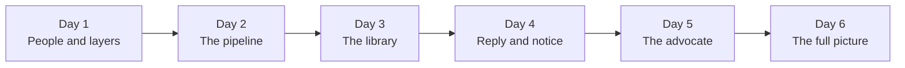
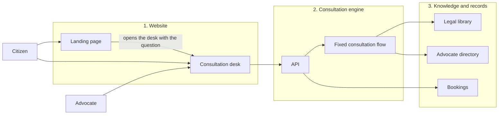
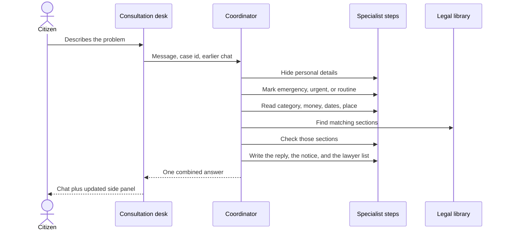

# OnlineVakeel — Architecture in Six Days
Read one portion a day. Each day has a short summary, a few subsections, and a diagram. The aim is to see the whole system clearly, without implementation detail.
OnlineVakeel helps a person in India describe a legal problem in everyday language, receive an answer tied to Indian statutes and known judgments, get a draft legal notice, and book a local advocate.
A deeper companion, with the same picture in one place, is `SYSTEM_DESIGN.md`.
## The six days
| Day | Portion | You will understand |
| --- | --- | --- |
| 1 | The product and its three layers | Who it is for, and the path from browser to answer |
| 2 | One question, one pipeline | How a message is turned into a case |
| 3 | The legal library | Why the answer quotes real sections |
| 4 | The reply and the notice | Where the words and the document come from |
| 5 | The human lawyer | How a case is matched, booked, and accepted |
| 6 | The whole system at rest | Screens, memory, two ways to run, and the limits |

---
# Day 1 — The product and its three layers
## Summary
OnlineVakeel is a consultation desk for Indian legal questions. A citizen describes a problem. The system answers in plain language, shows the related law, drafts a notice, and offers advocates near that city and court. An advocate uses the same desk to receive bookings and, after accepting, to see the citizen’s phone number. A third role, the operator, grows the legal library offline. The live product is three layers: a website, an API that runs the consultation, and the stores of law, lawyers, and bookings.
## Who it serves
**Citizen.** Opens the site, types a question, reads the guidance, reviews the notice, and books a lawyer. Example: “My builder in Bengaluru delayed my flat by two years after I paid ₹75 lakhs.”
**Advocate.** Registers with a Bar Council ID, signs in, and works an inbox of consultation requests. Contact details stay hidden until the advocate accepts.
**Operator.** Adds Bare Acts and court judgments to the library. This happens outside the chat, through separate ingest jobs.
The product prepares information and a document, then introduces a human lawyer. Filing a case and giving a licensed opinion remain with that advocate.
## The three layers

1. **Website.** The landing page takes the first question and opens the consultation desk. The desk is one screen with the chat, the laws, the notice, the advocate list, and the advocate login.
2. **Consultation engine.** One API receives every action from the desk. A consultation always follows the same sequence of steps. Day 2 walks that sequence.
3. **Knowledge and records.** A legal library, a directory of advocates, and the list of bookings. The library can run from a built-in set of statutes. A cloud database is optional and holds a larger library when it is configured.
Language models sit beside the engine. They help with wording when keys are present. The consultation still completes when they are absent. Day 4 covers that.
## What one visit produces
By the end of a turn the citizen can see four things at once:
- A plain-language reply
- The sections and judgments that reply rests on
- A draft pre-litigation notice
- Advocates ranked for that kind of case and that place
## Close of day
Remember the three layers: website, consultation engine, knowledge and records. Tomorrow is only about what happens inside the engine when one message arrives.
---
# Day 2 — One question, one pipeline
## Summary
Every citizen message takes the same path. A coordinator runs specialist steps in a fixed order. Each step does one job and returns a structured result. The steps do not hold a conversation with each other. The coordinator merges those results into one response. A later message in the same sitting reuses facts already collected, so the citizen does not have to repeat the amount, the city, or the kind of dispute.
## The path of a message

## The eight steps, in order
```mermaid
flowchart TD
    Q[Citizen message]
    Q --> A[1. Hide personal details]
    A --> B[2. Mark urgency]
    B --> C[3. Read the case]
    C --> D[4. Find the law]
    D --> E[5. Check the citations]
    E --> F[6. Write the reply]
    E --> G[7. Draft the notice]
    E --> H[8. Match advocates]
    F --> R[One response]
    G --> R
