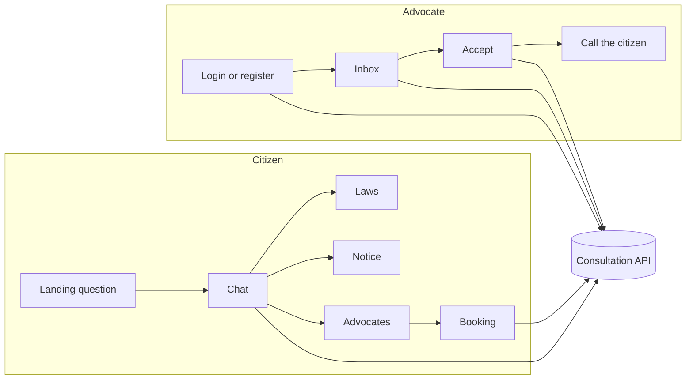
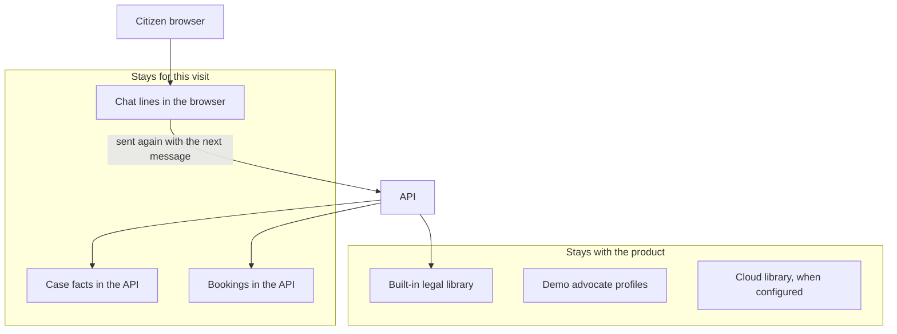
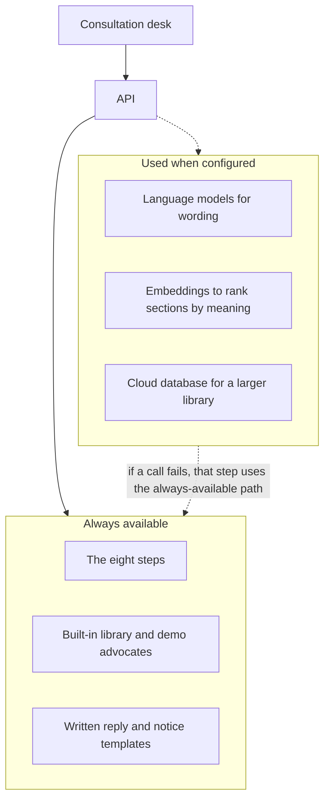
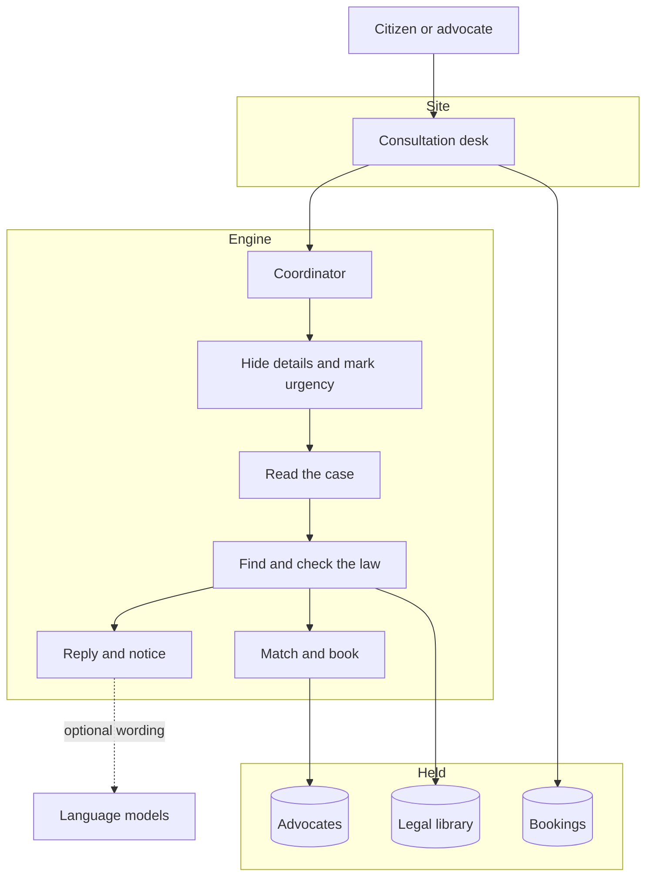

---
# Day 6 — The whole system at rest
## Summary
The citizen journey and the advocate journey meet on one desk and one API. The legal library is durable. The live case and the inbox of bookings live with the running API. The product runs with no keys at all, and it runs richer when models and a database are attached. Either way the same screens and the same pipeline apply. The system prepares guidance and a draft, then stops at the advocate: it does not file, it does not decide jurisdiction as a court would, and it does not replace licensed advice.
## The two journeys on one desk

The landing page only collects the question and opens the desk. Everything after that is the desk talking to the API: send a message, load the library view, list advocates, create a booking, sign an advocate in, list leads, accept or decline, read or write a review.
## What is remembered

| What | Where it sits | After a restart of the API |
| --- | --- | --- |
| The chat the citizen can still see | The browser, and it is sent again with the next message | Still in the open tab |
| Category, amount, place for that case | The API’s case memory | Cleared |
| Bookings and reviews created in the session | The API’s lead memory | Cleared |
| Built-in statutes and demo advocates | Shipped with the app | Still there |
| Extra sections loaded into the cloud database | The database | Still there |
The desk can continue a conversation after a refresh only for what the browser still holds. The engine’s own memory of the case is for the life of that API process. A single server is the shape this build is designed for.
## Two ways it runs

**Ready with nothing configured.** Built-in statutes, demo advocates, template explanations, template notices. The full citizen path and the advocate inbox can be demonstrated.
**Connected.** A general model and a Hindi-capable model for prose, an embedding service to help rank sections, and a cloud database for hybrid search over a larger corpus. If any of those calls fail, that step continues on the ready-with-nothing path. The rest of the turn still returns.
## The picture in one diagram

Read this from top to bottom: a person, a desk, a coordinator, safety, understanding the case, law, then words and a lawyer. The library feeds the law step. The directory feeds the match. Bookings are a separate record the desk creates after the citizen chooses someone.
## What to keep in mind
- The order of work is fixed, so every answer has the same parts: guidance, sources, a notice, and lawyers.
- Personal details are masked before search and before any model call.
- Citations come from the library, then pass a check.
- Wording can come from a model or from a template. The sources stay the same.
- The phone number appears to the advocate after acceptance.
- Place and court are a practical match for finding a lawyer. The advocate confirms where a matter should actually be filed.
- The draft notice is a document to review with that advocate. The system does not file it.
- Emergency situations still return an answer, and they surface public helplines first.
## Close of the six days
You now have the full architecture at the level of people, flow, sources, writing, handoff, and runtime. Day 1 was who and where. Day 2 was the eight steps. Day 3 was the library. Day 4 was the reply and the notice. Day 5 was the advocate. Day 6 is how those parts sit together, what lasts, and where the product stops so a human lawyer can take over.
