# OnlineVakeel — Architecture in Six Days

Read one portion a day. Each day has a short summary, a few subsections, and a diagram. The aim is to see the whole system clearly, without implementation detail.

OnlineVakeel helps a person in India describe a legal problem in everyday language, receive an answer tied to Indian statutes and known judgments, get a draft legal notice, and book a local advocate.

A deeper companion, with the same picture in one place, is `SYSTEM_DESIGN.md`.

## The six days

| Day | Portion | You will understand |
| --- | --- | --- |
| 1 | The product and its three layers | Who it is for, and the path from browser to answer |
| 2 | One question, one pipeline | How a message is turned into a case |
| 3 | The legal library | Why the answer quotes real sections |
| 4 | The reply and the notice | Where the words and the document come from |
| 5 | The human lawyer | How a case is matched, booked, and accepted |
| 6 | The whole system at rest | Screens, memory, two ways to run, and the limits |

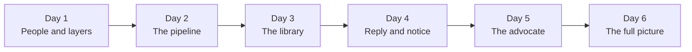

---

# Day 1 — The product and its three layers

## Summary

OnlineVakeel is a consultation desk for Indian legal questions. A citizen describes a problem. The system answers in plain language, shows the related law, drafts a notice, and offers advocates near that city and court. An advocate uses the same desk to receive bookings and, after accepting, to see the citizen’s phone number. A third role, the operator, grows the legal library offline. The live product is three layers: a website, an API that runs the consultation, and the stores of law, lawyers, and bookings.

## Who it serves

**Citizen.** Opens the site, types a question, reads the guidance, reviews the notice, and books a lawyer. Example: “My builder in Bengaluru delayed my flat by two years after I paid ₹75 lakhs.”

**Advocate.** Registers with a Bar Council ID, signs in, and works an inbox of consultation requests. Contact details stay hidden until the advocate accepts.

**Operator.** Adds Bare Acts and court judgments to the library. This happens outside the chat, through separate ingest jobs.

The product prepares information and a document, then introduces a human lawyer. Filing a case and giving a licensed opinion remain with that advocate.

## The three layers

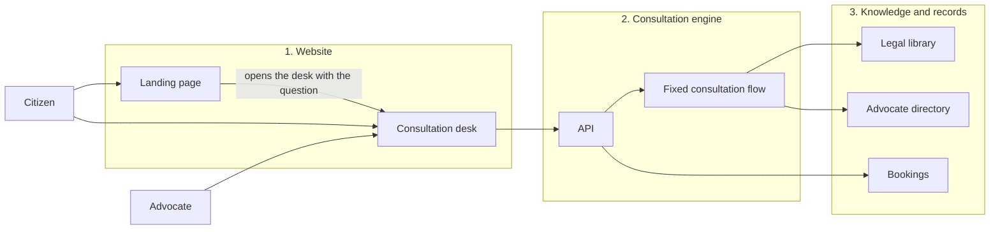

1. **Website.** The landing page takes the first question and opens the consultation desk. The desk is one screen with the chat, the laws, the notice, the advocate list, and the advocate login.
2. **Consultation engine.** One API receives every action from the desk. A consultation always follows the same sequence of steps. Day 2 walks that sequence.
3. **Knowledge and records.** A legal library, a directory of advocates, and the list of bookings. The library can run from a built-in set of statutes. A cloud database is optional and holds a larger library when it is configured.

Language models sit beside the engine. They help with wording when keys are present. The consultation still completes when they are absent. Day 4 covers that.

## What one visit produces

By the end of a turn the citizen can see four things at once:

- A plain-language reply
- The sections and judgments that reply rests on
- A draft pre-litigation notice
- Advocates ranked for that kind of case and that place

## Close of day

Remember the three layers: website, consultation engine, knowledge and records. Tomorrow is only about what happens inside the engine when one message arrives.

---

# Day 2 — One question, one pipeline

## Summary

Every citizen message takes the same path. A coordinator runs specialist steps in a fixed order. Each step does one job and returns a structured result. The steps do not hold a conversation with each other. The coordinator merges those results into one response. A later message in the same sitting reuses facts already collected, so the citizen does not have to repeat the amount, the city, or the kind of dispute.

## The path of a message

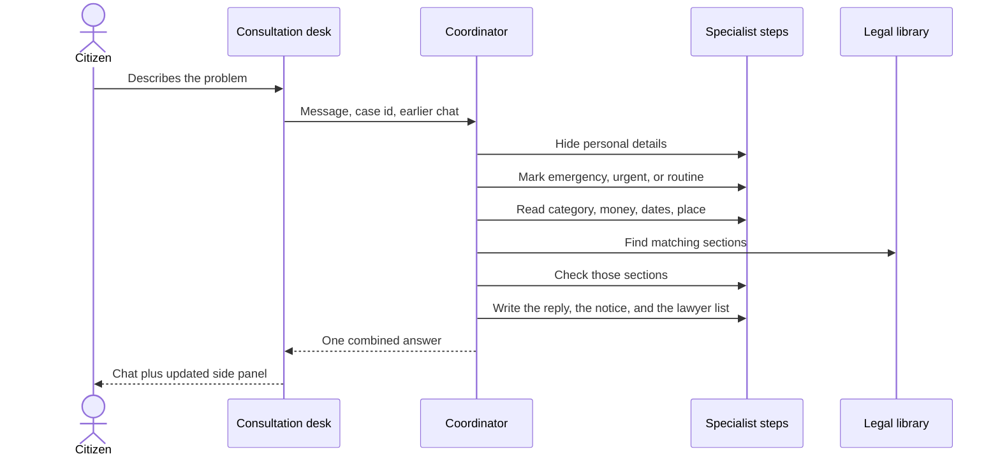

## The eight steps, in order

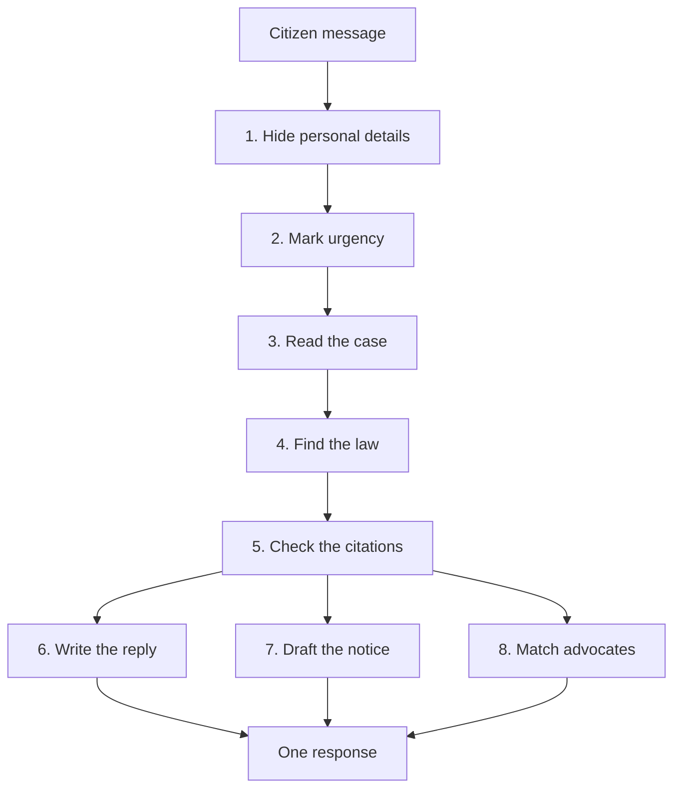

| Step | In plain words |
| --- | --- |
| 1. Hide personal details | Phone numbers, Aadhaar, PAN, and email are masked before any later step sees the text. |
| 2. Mark urgency | The message is labelled routine, urgent, or emergency. Emergency language brings public helplines forward in the reply. |
| 3. Read the case | The sentence becomes a category, an amount, dates, a city, a district, and a court. |
| 4. Find the law | The library is searched for a few matching sections and known judgments. Day 3. |
| 5. Check the citations | A section is shown with confidence only when it belongs to the trusted library. |
| 6. Write the reply | The words in the chat. Day 4. |
| 7. Draft the notice | The document in the notice panel. Day 4. |
| 8. Match advocates | A short brief and a ranked list of lawyers. Day 5. |

Steps 6, 7, and 8 all use the checked law and the extracted facts. They run as part of the same turn and come back together.

## What “a case” means

The first message creates a case id. The desk sends that id with every later message. The engine remembers, for that id:

- The legal category, unless the new message clearly starts a different kind of dispute
- Money, dates, and parties already mentioned
- City, locality, district, and court, updated when the citizen names a place

So a follow-up such as “It was in Whitefield and I have a video” fills gaps. It does not start from zero.

The desk also sends the earlier chat lines. The notice is refreshed from that full conversation, not from the latest sentence alone.

## How a dispute is recognised

The reading step maps everyday words onto a small set of themes:

- Cheque bounce
- Consumer complaint
- Property and builder delay
- Cyber fraud
- Employment
- Bail and police matters
- Right to information
- General civil, when none of the themes match

Place names work the same way. “Whitefield” or “Mayo Hall” can fill in Bengaluru and a court complex. “Saket” can fill in a Delhi court. This is a helpful default for matching a lawyer. It is a guide to where the matter seems to sit, and the advocate confirms jurisdiction.

## Safety on this path

Personal details are removed at the start, so search, drafting, and any language model see masks such as a redacted phone, not the number itself.

An emergency label does not cancel the rest of the pipeline. The citizen still receives guidance, and the reply leads with helplines: free legal aid 15100, police 112, the women helplines, the cyber-crime helpline 1930, and Tele-Law.

## Close of day

One message, eight steps, one packet back to the desk. The case id is how the next message continues the same matter. Tomorrow is step 4 and step 5: where the law comes from, and how a citation is allowed through.

---

# Day 3 — The legal library

## Summary

The reply is allowed to explain the law. It is not the source of the section numbers. A library of Indian Bare Act sections and a set of landmark judgments is searched first. The best few matches are checked against that trusted list. What passes is what the citizen sees, what the notice may cite, and what the advocate brief may rely on. The library ships with the product, so a consultation works before any cloud database is attached. A larger library can be added later.

## Why the library comes first

Indian criminal and evidence law changed in 2024. A general chat model can still mention older codes. OnlineVakeel keeps a curated set of current sections and a few well-known judgments, and it builds the answer from those rows.

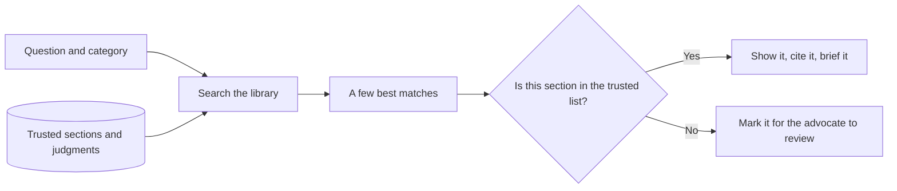

Each match carries, in simple form:

- The Act and the section
- A title
- A short plain-language summary
- The time limit that matters, when the library has one
- The kind of relief or consequence

The citizen sees these in the laws panel. The chat reply and the notice are written from this same set.

## How a match is chosen

The search looks for meaning and for obvious legal words.

- If an embedding service is configured, the question and each section can be compared by meaning.
- Words that strongly signal an area raise that area: builder and possession raise RERA, a bounced cheque raises the Negotiable Instruments Act, a video or a recording raises the electronic-evidence section, an RTI question raises the RTI Act.
- If a cloud database is connected, it can run a combined similarity-and-text search and return those rows first.

The search returns a handful of hits, not the whole library. If nothing scores, the citizen still sees a couple of known sections rather than an empty panel.

## What the library contains at a high level

The built-in set is a starter corpus, enough to demonstrate the main paths people ask about:

- Cheque dishonour
- Consumer complaints
- Builder delay and refund under RERA
- Cheating under the current criminal code
- Electronic records and the certificate they need
- Asking the police to investigate
- Unregistered agreements
- The right to information
- A few Supreme Court and High Court landmarks tied to those topics

Operators can add more by ingesting a Bare Act PDF, or by pulling public Supreme Court and High Court judgments. Those jobs write into the database. They are not part of the live chat.

## The check after search

The verifier compares each returned section with the trusted list. When the section is known, the response carries a verification badge. When it is not known, that citation is flagged for a lawyer to review before anyone treats it as settled.

The practical effect: the panel, the reply, and the notice share one checked set of sources for that turn.

## Close of day

Search, then check, then explain. The library is the source of citations. Tomorrow is how those checked sections become the paragraph in the chat and the notice in the side panel.

---

# Day 4 — The reply and the notice

## Summary

Two pieces of writing leave the engine on every turn: the chat reply and the legal notice. Both are built from the facts and the checked sections of that turn. A language model may phrase them when it is available. Written templates cover the same facts when it is not. The notice is refreshed as the conversation grows, and the citizen prints or downloads it from the browser.

## One turn, two writings

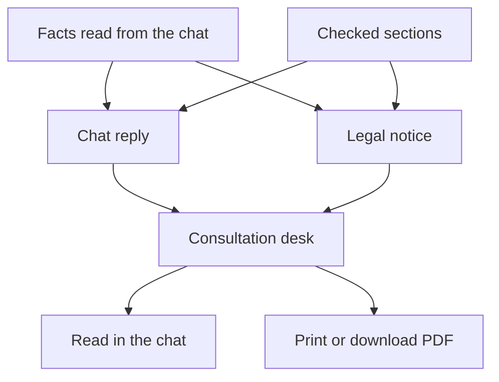

The reply is what the citizen reads as counsel in simple words: what the section means for their situation, what time limit matters, and what to do next. Examples of “next” are sending a demand notice, calling the cyber-crime helpline in a fraud, or filing an RTI.

The notice is a formal draft aimed at the other party. It uses the amount, the dates, the city, and the sections already retrieved. It is a draft for the citizen and, later, for the advocate. It is not a filed pleading.

## How the wording is chosen

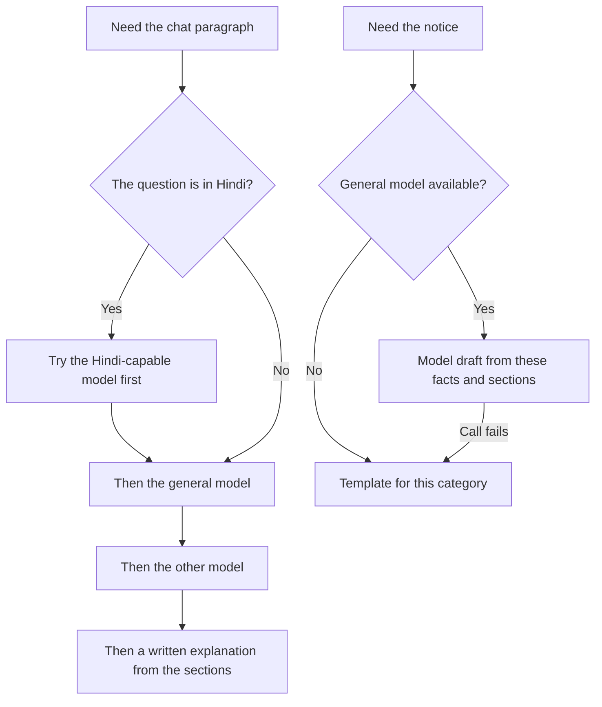

The model is given the category, the extracted facts, and the sections the library returned. Its job is to explain and to format. The section numbers come from the library step on Day 3.

If no model key is set, or a call fails, the written fallback still quotes those sections, the time limits, and the practical next step. A missing model changes the tone of the prose. The laws panel and the advocate list still arrive.

When the case has no city yet, the reply asks for the city or district, in English or Hindi, so a later turn can match a local advocate.

## How the notice stays in step with the chat

Each new citizen message is added to the story. The drafter re-reads the conversation and the structured facts.

Extra details change the draft in plain ways:

- A video or a call recording can bring in the electronic-evidence point
- A stamp-paper or unregistered agreement can bring in the registration point
- A cheque, a builder delay, or a consumer refund selects the notice shape for that theme

The desk shows the latest draft in the notice tab. Print uses a clean page with the notice alone. Download builds a PDF in the browser from that text. The server sends the words. The browser makes the paper.

## Close of day

The citizen-facing words and the document are two views of the same checked case. Models are optional authors. The library remains the source. Tomorrow the case leaves the screen and reaches a person: the advocate.

---

# Day 5 — The human lawyer

## Summary

The last specialist step prepares a short confidential brief and a ranked list of advocates. Ranking prefers the same district court, a nearby chamber, the same city, and a matching practice area. The citizen books a phone call, a video consult, or a chamber visit, and can attach the notice. The advocate sees the brief with identity hidden, accepts or declines, and sees the phone number only after accepting. A review can be left after that paid booking.

## From the answer to a booking

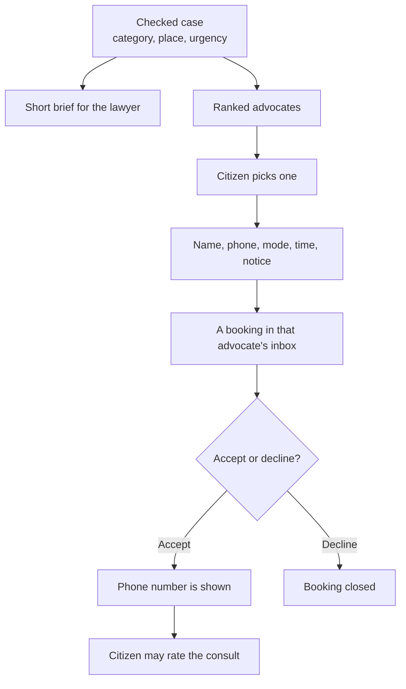

## What the advocate is matched on

The directory holds demo advocates and anyone who registers in the portal. Before ranking, a text search or a fee limit can narrow the list. Order then follows fit:

- Practising in the district court the citizen named
- Chamber in the same locality
- Same city
- Practice area aligned with the case, such as RERA for a builder dispute

The desk can show why someone rose to the top: same court, nearby chamber, or the city of the case. The citizen can also filter the list themselves.

## What is shared, and when

The brief describes the matter without handing over identity up front: case reference, category, urgency, city, amount, dates, and the main sections. The citizen’s name and phone are collected at booking time and stored on that lead.

Until the advocate accepts, the inbox shows the masked brief. Acceptance unlocks the phone number and a way to call. Decline closes the lead.

The notice text can travel with the booking, so the advocate can read the draft the citizen already saw.

## Trust around reviews

A rating is accepted when it belongs to a paid booking with that advocate. That keeps reviews tied to a real consultation in this product. In the current build, payment is recorded on the booking. A live payment gateway is a later connection. The rule is already there: a review follows a paid consult with that lawyer.

## Close of day

The pipeline’s last mile is a person. Matching is a ranking over the directory. Privacy of the phone number is an accept action. Tomorrow puts the website, the pipeline, the library, the writings, and the booking back into one picture, including what the system remembers and what it deliberately leaves to the advocate.

---

# Day 6 — The whole system at rest

## Summary

The citizen journey and the advocate journey meet on one desk and one API. The legal library is durable. The live case and the inbox of bookings live with the running API. The product runs with no keys at all, and it runs richer when models and a database are attached. Either way the same screens and the same pipeline apply. The system prepares guidance and a draft, then stops at the advocate: it does not file, it does not decide jurisdiction as a court would, and it does not replace licensed advice.

## The two journeys on one desk

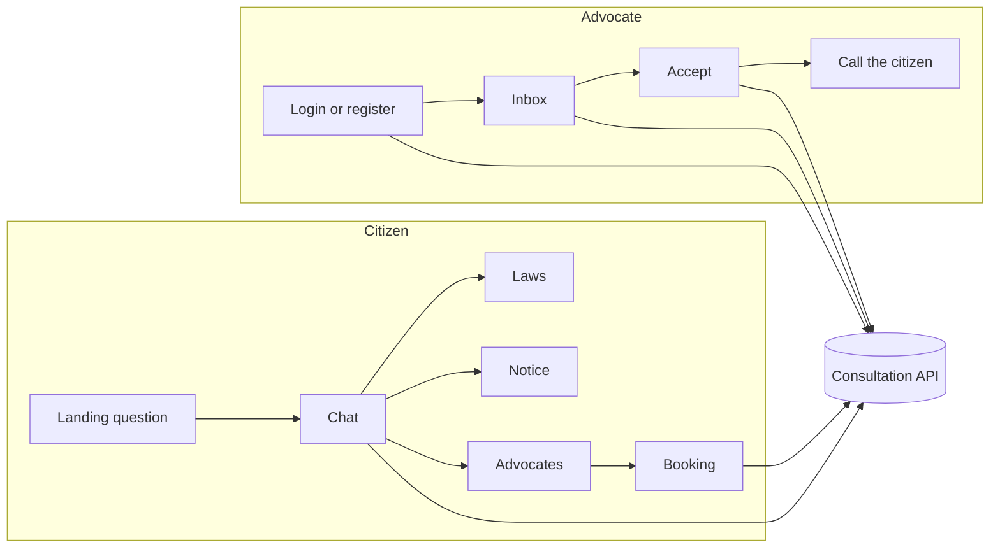

The landing page only collects the question and opens the desk. Everything after that is the desk talking to the API: send a message, load the library view, list advocates, create a booking, sign an advocate in, list leads, accept or decline, read or write a review.

## What is remembered

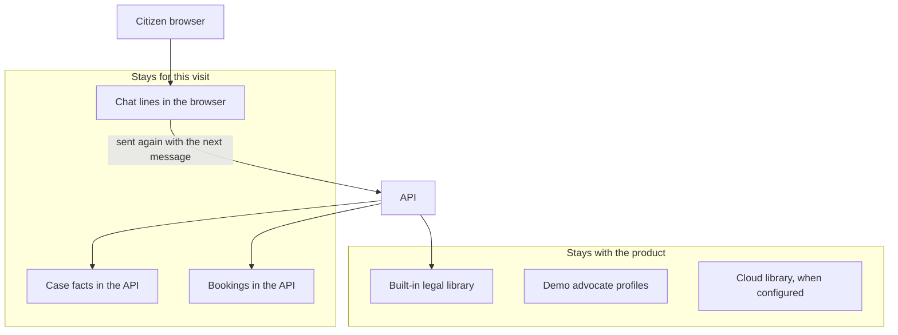

| What | Where it sits | After a restart of the API |
| --- | --- | --- |
| The chat the citizen can still see | The browser, and it is sent again with the next message | Still in the open tab |
| Category, amount, place for that case | The API’s case memory | Cleared |
| Bookings and reviews created in the session | The API’s lead memory | Cleared |
| Built-in statutes and demo advocates | Shipped with the app | Still there |
| Extra sections loaded into the cloud database | The database | Still there |

The desk can continue a conversation after a refresh only for what the browser still holds. The engine’s own memory of the case is for the life of that API process. A single server is the shape this build is designed for.

## Two ways it runs

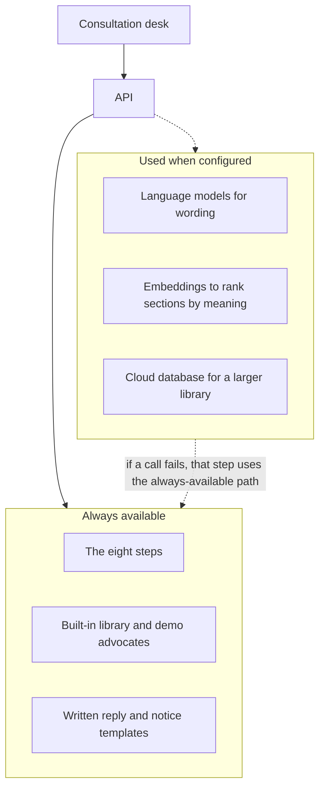

**Ready with nothing configured.** Built-in statutes, demo advocates, template explanations, template notices. The full citizen path and the advocate inbox can be demonstrated.

**Connected.** A general model and a Hindi-capable model for prose, an embedding service to help rank sections, and a cloud database for hybrid search over a larger corpus. If any of those calls fail, that step continues on the ready-with-nothing path. The rest of the turn still returns.

## The picture in one diagram

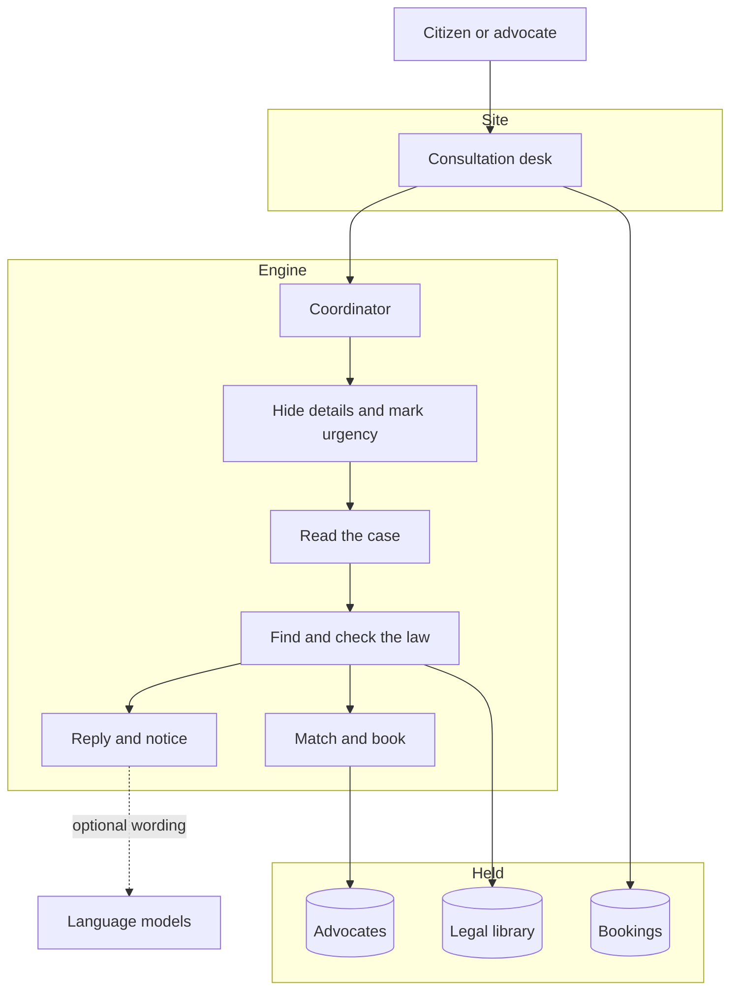

Read this from top to bottom: a person, a desk, a coordinator, safety, understanding the case, law, then words and a lawyer. The library feeds the law step. The directory feeds the match. Bookings are a separate record the desk creates after the citizen chooses someone.

## What to keep in mind

- The order of work is fixed, so every answer has the same parts: guidance, sources, a notice, and lawyers.
- Personal details are masked before search and before any model call.
- Citations come from the library, then pass a check.
- Wording can come from a model or from a template. The sources stay the same.
- The phone number appears to the advocate after acceptance.
- Place and court are a practical match for finding a lawyer. The advocate confirms where a matter should actually be filed.
- The draft notice is a document to review with that advocate. The system does not file it.
- Emergency situations still return an answer, and they surface public helplines first.

## Close of the six days

You now have the full architecture at the level of people, flow, sources, writing, handoff, and runtime. Day 1 was who and where. Day 2 was the eight steps. Day 3 was the library. Day 4 was the reply and the notice. Day 5 was the advocate. Day 6 is how those parts sit together, what lasts, and where the product stops so a human lawyer can take over.
