# OnlineVakeel — High-Level System Design

OnlineVakeel helps a person in India describe a legal problem in plain language, get an answer grounded in Indian statutes and known judgments, receive a draft pre-litigation document, and book a local advocate.

It is a **multi-agent application in the practical sense**: one coordinator runs a fixed sequence of specialist steps. The specialists do not chat with each other. Each step reads the case so far, does one job, and passes a structured result forward.

This document describes the system as it is built today (FastAPI backend, Next.js frontend). It uses simple language. Diagrams show who talks to whom.

---

## 1. What the system does

A citizen types a question such as “My builder in Bengaluru delayed my flat by two years after I paid ₹75 lakhs.”

The system then:

1. Hides personal identifiers (phone, Aadhaar, PAN, email) before anything else sees the text.
2. Checks whether the situation is an emergency (arrest, violence, suicide) or a deadline that is about to expire.
3. Turns the sentence into a case: legal category, money, dates, city, district, and court.
4. Looks up matching Bare Act sections and known judgments from a legal library.
5. Checks that those citations exist in the trusted library.
6. Writes a plain-language explanation (English or Hindi).
7. Drafts a legal notice that updates as the conversation continues.
8. Ranks verified advocates by practice area, city, locality, and district court.
9. Lets the citizen book a call, video, or chamber visit. The advocate sees a masked brief until they accept.

The product is **legal information and document preparation**, plus a path to a human lawyer. It is not a substitute for a court filing or a licensed opinion.

---

## 2. Who uses it

| User | What they do | Where they work |
| --- | --- | --- |
| Citizen | Asks a question, reads guidance, reviews the notice, books a lawyer | Landing page and Consultation Desk |
| Advocate | Registers with a Bar Council ID, signs in, accepts or declines leads, sees contact details only after acceptance | Advocate portal on the same Consultation Desk |
| Operator / developer | Ingests Bare Act PDFs and court judgments into the library | Offline scripts, not the live chat |

---

## 3. The big picture

Three layers sit between the user and the legal library.

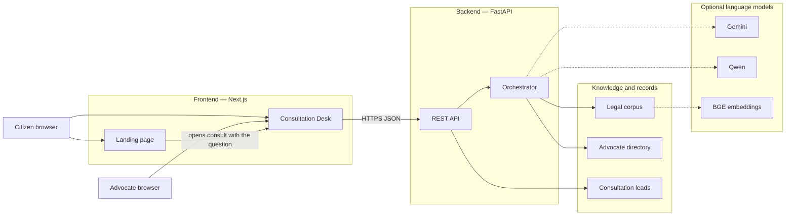

If a language-model key is missing, the chat and the notice still work. The system falls back to written templates and keyword rules. The legal library also works without a cloud database: a built-in set of Bare Acts and landmark cases is always available.

---

## 4. Main building blocks

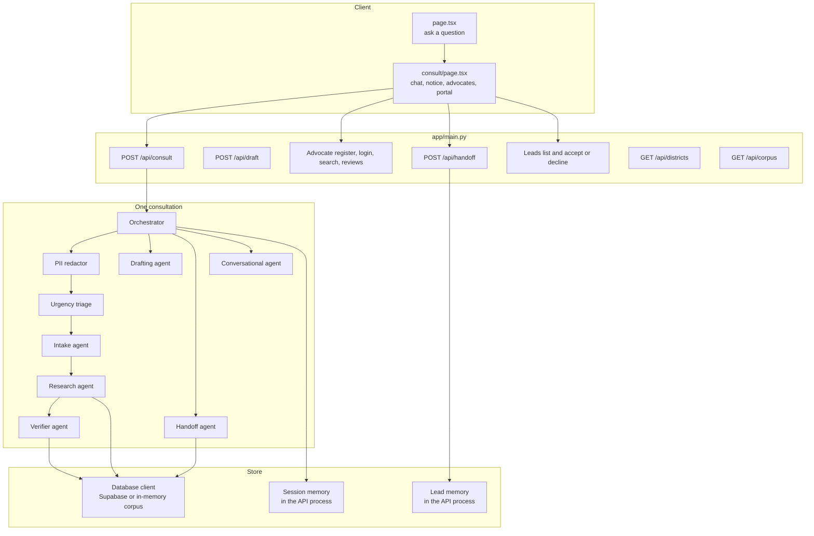

| Piece | Job in one sentence |
| --- | --- |
| Landing page | Collects the first question and opens the desk with that text. |
| Consultation Desk | Chat, dossier (laws, notice, advocates), and the advocate login. |
| FastAPI | The only door the browser uses. Validates requests and returns JSON. |
| Orchestrator | Runs the steps in order and keeps the case for follow-up messages. |
| Safety | Masks personal data, then labels emergency / urgent / routine. |
| Intake | Classifies the dispute and pulls out facts and place. |
| Research | Finds up to three matching sections from the library. |
| Verifier | Accepts a citation only if that section is in the trusted list. |
| Conversational agent | Turns those sections into a human reply. This is the only step that calls a chat model. |
| Drafting agent | Builds or refreshes the notice from the same facts. May call Gemini; otherwise uses a template. |
| Handoff agent | Writes a short brief and asks the directory for ranked lawyers. |
| Database client | Searches laws and lawyers. Uses Supabase when configured, otherwise the built-in lists. |

---

## 5. How one question is answered

Every message to `POST /api/consult` walks the same path. Later messages in the same session reuse facts already collected (money, dates, city, category) so the user does not have to repeat them.

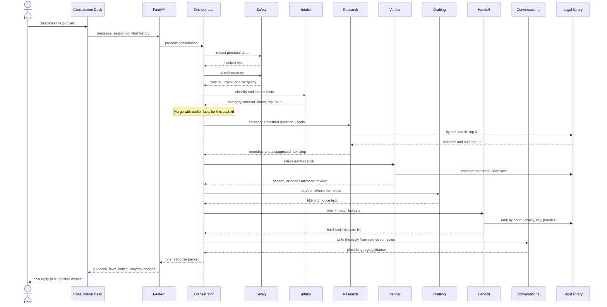

The reply packet always contains the same kinds of fields: case id, category, urgency, extracted facts, guidance text, statutory remedies, verification result, draft notice, advocate brief, and matched advocates.

### What “session” means

The orchestrator keeps cases in memory, keyed by case id. The browser sends that id back as `session_id`.

On a follow-up:

- If the new message looks like a general remark, the earlier legal category is kept.
- New amounts, dates, parties, city, locality, and court fill in blanks or replace older place names when the user states them again.
- The notice is regenerated from the full chat, so a later sentence (“I have a video recording”) can add the electronic-evidence paragraph.

Restarting the API clears this memory. Leads booked with an advocate live in a separate in-memory list on the API, also cleared on restart, unless a real database is wired later.

---

## 6. The agents, and how they depend on each other

They are specialists behind one coordinator. Arrows mean “this step’s output is an input to the next.” There is no agent-to-agent conversation.

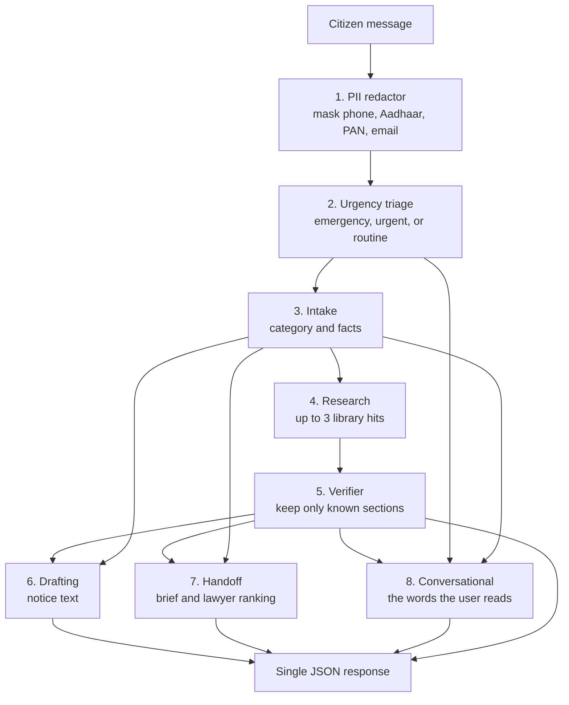

| Step | Reads | Produces | Uses a language model? |
| --- | --- | --- | --- |
| PII redactor | Raw message | Masked text and a list of what was hidden | No. Pattern matching. |
| Urgency triage | Masked text | `emergency`, `urgent`, or `routine`, plus helplines when needed | No. Keyword lists. |
| Intake | Masked text and prior chat | One of 8 categories, money, dates, parties, district, state, court | No. Keywords plus a district catalog. |
| Research | Category, question, facts | Remedies: Act, section, plain summary, limitation, relief | No for the decision. Optional embedding model only to rank library rows. |
| Verifier | Those remedies | Pass, or “needs advocate review,” plus a badge | No. Exact match against the built-in corpus. |
| Drafting | Category, facts, full user chat, remedies | Notice title and body | Gemini if a key exists; otherwise a fixed notice template. |
| Handoff | Case, category, facts, remedies, urgency | Confidential brief and ranked advocates | No. |
| Conversational | Masked question, facts, remedies, triage, history | The chat answer | Hindi prefers Qwen, then Gemini, then Qwen again, then a written explanation. English prefers Gemini, then Qwen, then the written explanation. |

### Intake categories

The intake step picks the first matching theme:

- Cheque bounce
- Consumer dispute
- Property and RERA
- Cyber fraud
- Employment and labour
- Criminal bail
- RTI and public authorities
- General civil, when none of the above match

Place is resolved from aliases (for example “Whitefield” or “Mayo Hall”) and from a catalog of Indian districts and their courts. Mentioning a court can fill in the city; mentioning a city can fill in a default court complex.

### Safety behaviour

Emergency language (arrest, custody, domestic violence, threat to life, and similar phrases) does **not** stop the pipeline. The conversational reply is instructed to lead with helplines: NALSA 15100, police 112, women 1091 / 181, cyber crime 1930, and Tele-Law 14430. Urgent language (limitation about to expire, summons, eviction today) marks the case urgent and still returns legal guidance.

Personal data is masked **before** intake, search, drafting, and any model call. The masks look like `[PHONE_REDACTED]`. The original numbers are not sent to Gemini, Qwen, or the embedding service.

---

## 7. How the answer stays tied to real law

The design goal is: the model may explain, but it may not invent the statute.

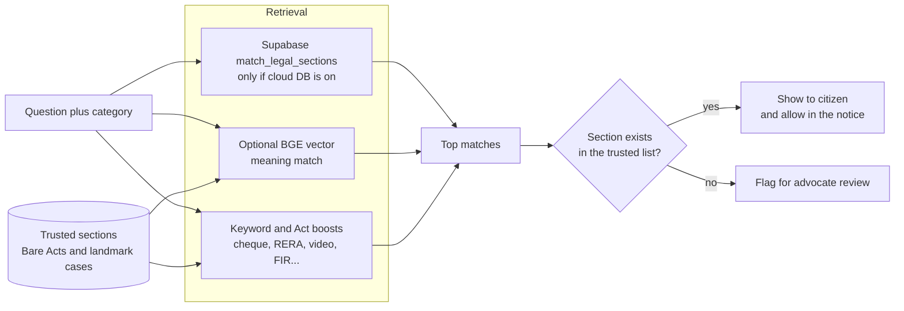

Search order:

1. If Supabase is connected, call the database function `match_legal_sections` (vector plus text). Use that result when it returns rows.
2. Otherwise score the built-in library: embedding similarity when the embedding service is configured, plus strong keyword boosts (for example “builder” and “possession” raise RERA; “video” and “recording” raise the electronic-evidence section).
3. Return the best few rows. If nothing scores, return the first two library entries so the user still sees something known rather than a blank answer.

The verifier then checks section number and Act name against that same built-in list. A hit that is not in the list is marked for a human lawyer. The badge the user sees is either “Verified by Indian Bare Acts Engine” or “Pending Advocate Review.”

The library that ships with the app covers, among others: Negotiable Instruments Act (cheque bounce), Consumer Protection Act, RERA, Bharatiya Nyaya Sanhita (cheating), Bharatiya Sakshya Adhiniyam (electronic records), Bharatiya Nagarik Suraksha Sanhita (police investigation), Registration Act, RTI Act, and a handful of Supreme Court and High Court landmarks (including delayed-possession, cheque jurisdiction, electronic evidence, and a cyber-fraud illustration).

Two offline scripts grow that library when a database is configured:

- `ingest_pdf.py` — read a Bare Act PDF, split sections, optionally summarise with Gemini, store rows.
- `sync_aws_court_data.py` — pull public Supreme Court and High Court judgment PDFs from AWS Open Data and store holdings. No AWS account is required for the public buckets.

---

## 8. How the notice is created

The notice is a second product of the same turn, not a separate conversation.

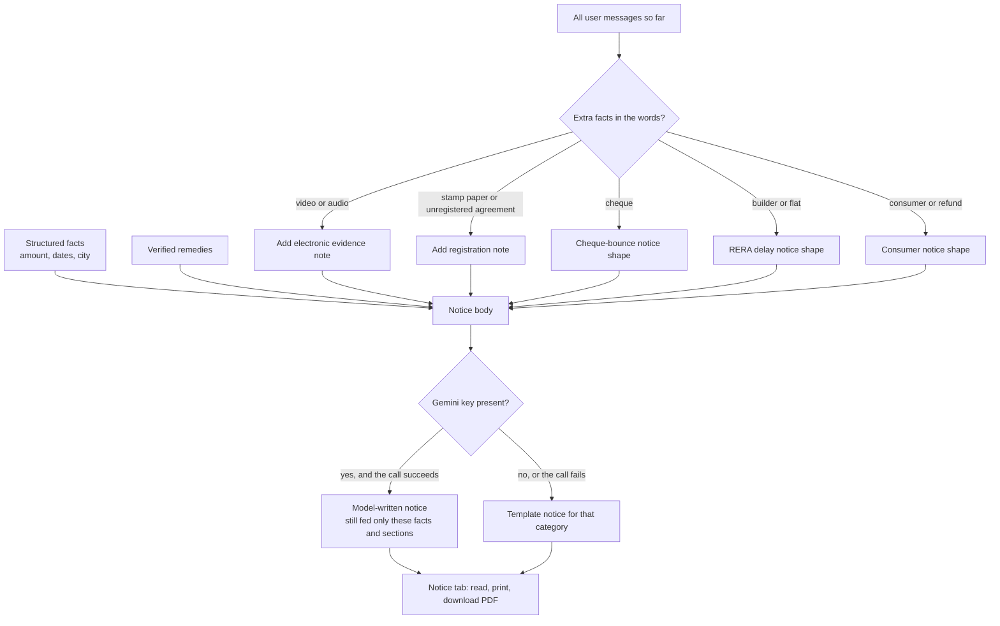

The browser renders the notice, prints it in a clean frame (without the rest of the website), and can download a PDF. The PDF is made in the browser. The server returns the text.

---

## 9. From answer to a human lawyer

Matching is a score, not a separate AI agent. Higher score means a closer fit. Filters (search text, maximum fee) remove people first; ranking orders who remains.

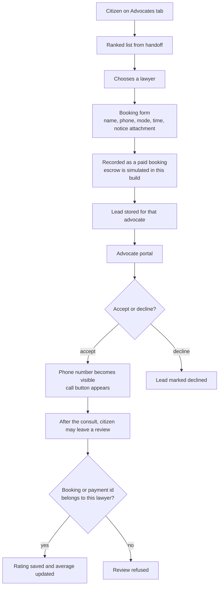

Ranking weights, applied in the directory:

| Signal | Why it matters | Points |
| --- | --- | --- |
| Same district court | The lawyer actually appears in that court | +50 |
| Office in the same locality | Chamber is near the citizen | +40 |
| Same city, or locality named inside the city | Territorial fit | +20 to +25 |
| Practice area matches the case category | A RERA matter prefers a RERA lawyer | +15 |

The brief sent with the match hides identity until acceptance: amount, dates, city, urgency, and the top statutory grounds. The citizen’s phone is stored on the lead and shown to the advocate only after they accept.

Reviews require a paid booking or payment id for that advocate. This stops anonymous ratings.

---

## 10. Language models, and life without them

Only two steps speak to a chat model. Search may call an embedding model. Everything else is rules.

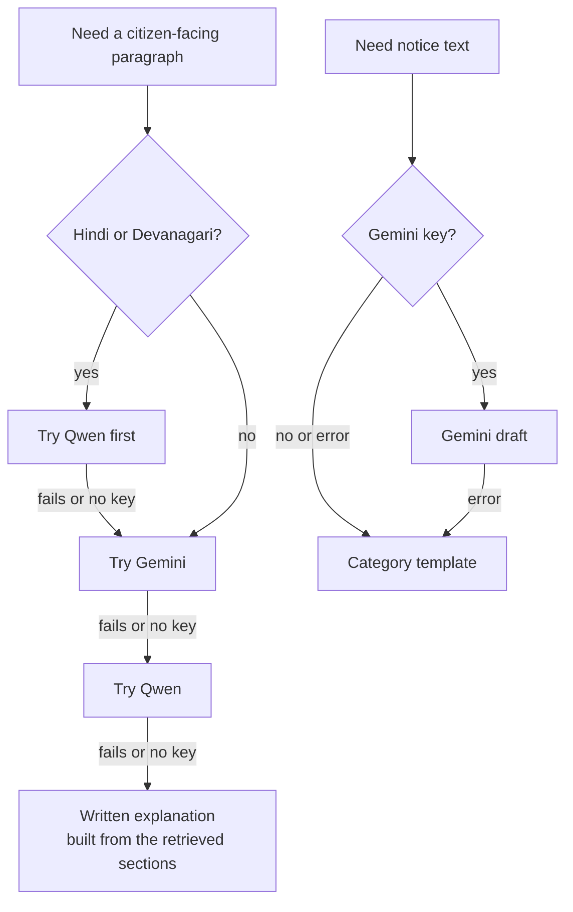

The model is not asked to “know Indian law” on its own. The prompt is filled with the category, the extracted facts, and the sections the library already returned. If the model is down, the written fallback still quotes those same sections, limitation periods, and the next practical step (send a notice, call 1930, file an RTI, and so on).

If the intake step never found a city, the conversational step adds a short question asking for city or district, in English or Hindi.

---

## 11. Data the system remembers

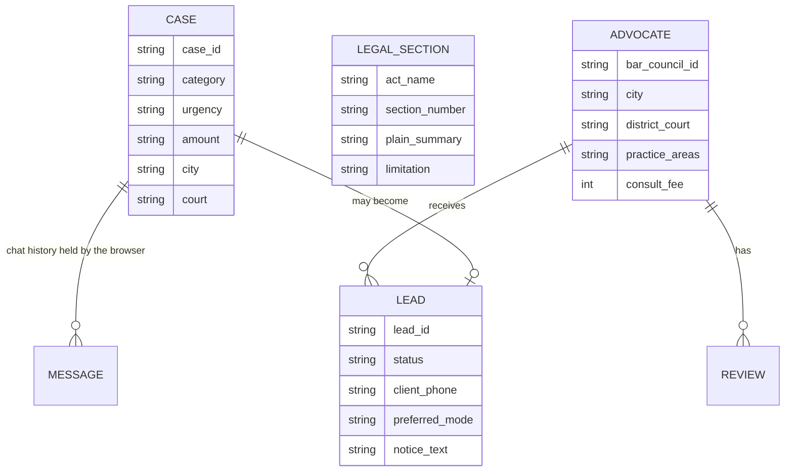

| Data | Where it lives today | Survives a restart? |
| --- | --- | --- |
| Chat transcript | Browser, sent back as `history` | Yes, until the tab is closed |
| Case facts (category, money, place) | Orchestrator memory in the API process | No |
| Legal sections | Built-in list; Supabase `legal_corpus` when configured | Yes for the built-in list; yes in Supabase if used |
| Advocate profiles added in the UI | API process list, plus built-in demo profiles | Custom registrations: no. Demo profiles: yes |
| Booked leads | API process list | No |
| Reviews | API process map | No |

Supabase, when URL and key are set, is the intended durable store for the legal corpus (with `pgvector` for similarity search) and can back the advocate directory. The consultation path in this codebase still keeps the live case and the lead inbox in process memory.

District and court names used by intake and by `GET /api/districts` come from a static catalog in the backend, mirrored for the UI.

---

## 12. The screens and the API they call

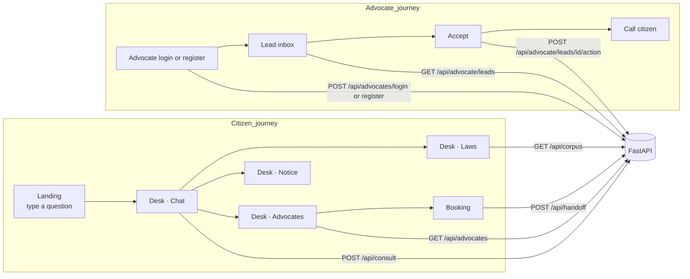

| Endpoint | Purpose |
| --- | --- |
| `GET /health` | Process is up; reports whether Supabase and Gemini are configured. |
| `POST /api/consult` | Full agent pipeline for one message. |
| `POST /api/draft` | Notice only, if a caller already has category and facts. |
| `GET /api/corpus` | List the built-in library for the Laws view. |
| `GET /api/districts` | Search states, districts, and courts. |
| `GET /api/advocates` | Filter and rank lawyers. |
| `POST /api/advocates/register` | Add a lawyer profile. |
| `POST /api/advocates/login` | Match Bar Council ID, email, or name. Returns a simple token string. |
| `POST /api/handoff` | Create a consultation lead. |
| `GET /api/advocate/leads` | Inbox, optionally for one advocate. |
| `POST /api/advocate/leads/{id}/action` | Accept or decline. |
| `POST /api/advocates/{id}/reviews` | Save a review after a paid booking. |
| `GET /api/advocates/{id}/reviews` | Read reviews. |

The browser talks only to this API (`NEXT_PUBLIC_API_URL`, default `http://localhost:8000`). The API allows browser calls from any origin so the local Next.js app on port 3000 can reach it.

---

## 13. Runtime shape

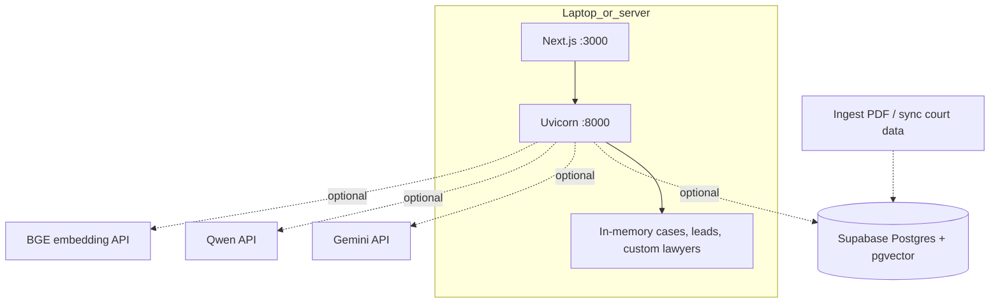

Two modes:

- **Zero-config.** No keys. Built-in statutes, demo advocates, template notices, template explanations. Enough to demonstrate the full citizen and advocate journey.
- **Connected.** Gemini and/or Qwen for wording, BGE for semantic ranking, Supabase for a larger corpus and the hybrid search function. If any of these calls fail, the same request continues on the zero-config path for that step.

There is one API process. It is a good fit for a demo and a single server. Case state and leads are not shared across multiple servers and are lost when the process stops.

---

## 14. Design choices, stated simply

**One coordinator, fixed order.** The user always gets laws, a check, a notice, a lawyer list, and a paragraph. A free-form swarm of agents would be harder to explain and easier to drift off the library.

**Rules before models.** Category, place, urgency, citation checks, and lawyer ranking do not depend on a model being awake or truthful.

**Library before prose.** The conversational and drafting steps are downstream of retrieval. They explain and format. They are not the source of the section numbers.

**Mask first.** Personal identifiers are stripped before search and before any outbound model call.

**Degrade, do not fail closed on wording.** A missing model key changes the tone of the paragraph and the notice. It does not remove the statutory hits or the lawyer list.

**Human at the end.** The product’s last mile is a Bar Council profile, a booking, and an accept action that reveals contact details. Emergency queries surface public helplines in the same response.

---

## 15. What this design does not claim

- Login is an identifier match. It does not verify a password against a secure store, and the token is not a signed session.
- “Verified advocate” in the demo data means the profile is present in the directory, not that a Bar Council API confirmed the enrolment.
- Payment and escrow are recorded on the lead. No payment gateway is called.
- The verifier checks the built-in corpus. A section that exists only in Supabase can be flagged even if retrieval returned it.
- Court and city mapping uses aliases and a district catalog. It is a helpful default, not a judicial determination of territorial jurisdiction.
- The system gives information and drafts. Filing, representation, and privileged advice stay with the advocate the citizen books.
