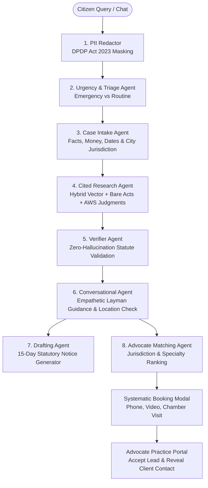

# OnlineVakeel.com — Multi-Agent AI Legal Aid, RAG Citation Engine & Advocate Portal

An enterprise-grade, DPDP Act 2023–compliant legal platform for India. OnlineVakeel combines a **7-agent legal counsel engine**, a **hybrid RAG citation system grounded in Indian Bare Acts and AWS Open Data Supreme Court & High Court judgments**, an **automated pre-litigation legal notice drafter**, and a **Bar Council–verified advocate marketplace**.

---

## ⚡ Quickstart: Run on Localhost in 3 Minutes

### 1. Clone the Repository
```bash
git clone https://github.com/theankushjain/onlinevakeel.git
cd onlinevakeel
```

### 2. Start the Backend (FastAPI + Multi-Agent Engine)
```bash
cd backend
python3 -m venv venv
source venv/bin/activate       # On Windows: venv\Scripts\activate
pip install -r requirements.txt
cp .env.example .env
uvicorn app.main:app --host 0.0.0.0 --port 8000 --reload
```
> **Zero-Config Ready**: The backend works out-of-the-box in zero-config dev mode with pre-seeded Indian Bare Acts, landmark precedents, and advocate profiles without requiring an external database. To enable full cloud LLM features, optionally add your free `GEMINI_API_KEY` to `backend/.env`.

### 3. Start the Frontend (Next.js 14 App Router)
In a **new terminal tab**:
```bash
cd frontend
npm install
cp .env.local.example .env.local
npm run dev
```

### 4. Access the Application
- **Citizen Portal & Consultation Desk**: [http://localhost:3000](http://localhost:3000)
- **Advocate Practice Desk**: [http://localhost:3000/consult](http://localhost:3000/consult) (click *Advocate Login*)
- **Interactive Backend API Docs (Swagger)**: [http://localhost:8000/docs](http://localhost:8000/docs)

---

## Table of Contents
1. [Quickstart Guide](#-quickstart-run-on-localhost-in-3-minutes)
2. [System Architecture & Multi-Agent Flow](#system-architecture--multi-agent-flow)
3. [Key Capabilities](#key-capabilities)
4. [Tech Stack & Dependencies](#tech-stack--dependencies)
5. [Project Structure](#project-structure)
6. [Prerequisites & System Requirements](#prerequisites--system-requirements)
7. [Detailed Setup & Database Ingestion](#detailed-setup--database-ingestion)
8. [Advocate Portal & Consultation Booking System](#advocate-portal--consultation-booking-system)
9. [Pre-Litigation Legal Notice Drafter](#pre-litigation-legal-notice-drafter)
10. [Complete REST API Reference](#complete-rest-api-reference)
11. [Troubleshooting & FAQs](#troubleshooting--faqs)

---

> 📘 **Deep Dive Architecture & LLM Evaluation Guide**: For an exhaustive technical breakdown of all 8 agents, why generic LLMs fail in Indian law, and the precision enhancement roadmap, see [ONLINEVAKEEL_SYSTEM_ARCHITECTURE.md](file:///Users/apple/Desktop/Projects/onlinevakeel.com/ONLINEVAKEEL_SYSTEM_ARCHITECTURE.md).

## System Architecture & Multi-Agent Flow

OnlineVakeel does not rely on a single unconstrained prompt. Consultations are executed through a sequential, state-managed multi-agent pipeline:



### Specialized Agents in the Pipeline:
1. **PII Redaction Engine** (`backend/app/safety/pii_redactor.py`): Automatically redacts Aadhaar numbers, PAN cards, phone numbers, and emails before any LLM or external vector store call.
2. **Urgency & Triage Agent** (`backend/app/agents/triage_agent.py`): Triages cases into Routine, Urgent, or Emergency. Immediately surfaces statutory emergency helplines (NALSA Free Legal Aid `15100`, National Cyber Crime `1930`, Women Helpline `1091`, Emergency `112`).
3. **Case Intake Agent** (`backend/app/agents/intake_agent.py`): Classifies disputes across 7+ Indian legal domains (*Cheque Bounce NI 138, RERA Builder Delays, Consumer CPA 35, Cyber Cheating BNS 318, Employment/Labour, Criminal Bail, RTI*), extracts monetary stakes, incident dates, and identifies 40+ Indian legal cities/districts.
4. **Research / RAG Agent** (`backend/app/agents/research_agent.py`): Executes hybrid semantic search (vector cosine similarity + full-text BM25) over the indexed statutory corpus and landmark precedents.
5. **Citation Verification Agent** (`backend/app/agents/verifier_agent.py`): Verifies every section number, Act title, limitation deadline, and penalty against the internal corpus before returning it to the user.
6. **Conversational Counsel Agent** (`backend/app/agents/conversational_agent.py`): Translates statutory legal jargon into warm, empathetic guidance over tea. If the user's location is missing, it actively prompts them for their city/district.
7. **Drafting Agent** (`backend/app/agents/drafting_agent.py`): Formats tailored 15-day pre-litigation legal demand notices, incorporating Section 63 BSA electronic evidence certificates, Section 49 Registration Act collateral provisions, and limitation dates.
8. **Advocate Handoff & Booking Agent** (`backend/app/database/supabase_client.py`): Pairs citizens with verified advocates licensed before their local District Court or High Court.

---

## Key Capabilities

- **Zero-Config Dev Mode**: Works immediately out of the box with built-in Indian Bare Acts, landmark precedents, and verified advocate profiles without requiring a live Supabase or external API key.
- **AWS Open Data Integration**: Public S3 connectors stream judgments directly from `s3://indian-supreme-court-judgments/` (1950–2025) and `s3://indian-high-court-judgments/` (25 High Courts) with zero AWS credentials.
- **Synchronized Legal Notice**: Updates dynamically as the consultation unfolds, formatted with Markdown, isolated print engine, and instant PDF download via `jsPDF`.
- **Advocate Bar Portal**: Full registration for practicing counsel (Bar Council ID, State Bar, Courts, Practice areas, Session fees), 1-click demo logins, and a practice dashboard where client phone numbers are revealed upon consultation acceptance under DPDP compliance.
- **Systematic Consultation Booking**: Citizens select consultation mode (Phone Call, Video Consult, Court Chamber Visit), choose time windows, and attach pre-briefing case notices.

---

## Tech Stack & Dependencies

### Backend
- **Language**: Python 3.9+
- **Framework**: FastAPI (Asynchronous REST API)
- **Server**: Uvicorn with auto-reload
- **Validation**: Pydantic v2
- **PDF Extraction**: `pypdf` (100% pure Python, zero C dependencies)
- **Database Client**: `supabase-py` (PostgreSQL + `pgvector` RPC)
- **HTTP Client**: `httpx`

### Frontend
- **Framework**: Next.js 14 (App Router)
- **Language**: TypeScript
- **Styling**: Vanilla CSS (Tailored legal design system, responsive grid, glassmorphism, isolated `@media print` engine)
- **Icons**: Lucide React
- **Document Rendering**: `react-markdown`
- **PDF Generation**: `jspdf`

### Database & Storage
- **Platform**: Supabase Cloud or Local PostgreSQL
- **Extensions**: `uuid-ossp`, `vector` (pgvector), `pgcrypto`
- **Search**: HNSW vector cosine similarity + GIN full-text search (`tsvector`)

---

## Project Structure

```
onlinevakeel.com/
├── README.md                           # Master Documentation & Reproduction Guide
├── supabase/
│   └── migrations/
│       └── 20261112_init.sql          # Complete Supabase pgvector schema, tables & seed
├── backend/
│   ├── requirements.txt               # Backend Python dependencies
│   ├── .env.example                   # Environment variable template
│   ├── .env                           # Local environment configuration
│   ├── scripts/
│   │   ├── ingest_pdf.py              # Turnkey PDF Bare Act & Document Ingestion
│   │   └── sync_aws_court_data.py     # AWS Open Data Supreme Court & High Court sync
│   └── app/
│       ├── main.py                    # FastAPI entrypoint & REST endpoints
│       ├── config.py                  # Environment settings & configuration
│       ├── agents/
│       │   ├── orchestrator.py        # Multi-agent consultation coordinator
│       │   ├── intake_agent.py        # Case fact, dates & city jurisdiction extractor
│       │   ├── triage_agent.py        # Urgency classification & emergency helplines
│       │   ├── research_agent.py      # Cited legal RAG retrieval agent
│       │   ├── verifier_agent.py      # Anti-hallucination citation validator
│       │   ├── conversational_agent.py# Layman counsel explanation & location prompter
│       │   └── drafting_agent.py      # Statutory legal notice generator
│       ├── database/
│       │   └── supabase_client.py     # Database client, fallback corpus & advocate store
│       └── safety/
│           └── pii_redactor.py        # DPDP Act Aadhaar/PAN/phone redactor
└── frontend/
    ├── package.json                   # Frontend dependencies
    ├── tsconfig.json                  # TypeScript configuration
    ├── .env.local.example             # Frontend environment template
    ├── .env.local                     # Local frontend configuration
    └── src/
        └── app/
            ├── layout.tsx             # Root layout & Google Fonts
            ├── globals.css            # Design tokens, components, print media styles
            ├── page.tsx               # Minimalist landing page with chat field
            └── consult/
                └── page.tsx           # Full Consultation Desk, Notice Drafter & Advocate Portal
```

---

## Prerequisites & System Requirements

- **Operating System**: macOS, Linux, or Windows (WSL recommended)
- **Node.js**: v18.0.0 or higher
- **Python**: v3.9.0 or higher
- **Package Managers**: `npm` and `pip`
- **Git**

---

## Step-by-Step Reproduction Guide

### Step 1: Clone the Repository
```bash
git clone https://github.com/your-username/onlinevakeel.com.git
cd onlinevakeel.com
```

---

### Step 2: Database Setup (Supabase pgvector)

OnlineVakeel includes a zero-config fallback. However, to enable the full pgvector RAG database in production:

1. Create a free account at [supabase.com](https://supabase.com) and create a new project.
2. Go to **SQL Editor** in your Supabase dashboard.
3. Open `supabase/migrations/20261112_init.sql`, paste the entire script, and click **Run**.
   - This enables the `vector` extension.
   - Creates the tables: `profiles`, `advocate_profiles`, `cases`, `chat_messages`, `legal_corpus`, `advocate_handoffs`, `audit_logs`.
   - Creates the HNSW index and automated full-text search trigger `trg_legal_corpus_tsv`.
   - Installs the stored procedure `match_legal_sections` for hybrid vector RAG.
   - Pre-seeds core Indian Bare Acts.
4. Copy your **Project URL** and **Anon Key** from **Project Settings → API**.

---

### Step 3: Backend Setup (FastAPI & Agents)

1. Open a terminal and navigate to `backend/`:
   ```bash
   cd backend
   ```
2. Create and activate a Python virtual environment:
   ```bash
   python3 -m venv venv
   source venv/bin/activate  # On Windows: venv\Scripts\activate
   ```
3. Install dependencies:
   ```bash
   pip install -r requirements.txt
   ```
4. Configure environment variables:
   ```bash
   cp .env.example .env
   ```
   Edit `.env` with your preferred settings:
   ```env
   # Database (Leave blank to use internal zero-config Indian legal store)
   SUPABASE_URL=https://your-project.supabase.co
   SUPABASE_KEY=your-supabase-anon-or-service-role-key

   # LLM (Free Google Gemini API key: https://aistudio.google.com/app/apikey)
   GEMINI_API_KEY=your_gemini_api_key

   # Environment
   APP_ENV=development
   PORT=8000
   ```
5. Start the backend server:
   ```bash
   uvicorn app.main:app --host 0.0.0.0 --port 8000 --reload
   ```
   The backend API will be live at `http://localhost:8000`. You can inspect the interactive Swagger docs at `http://localhost:8000/docs`.

---

### Step 4: Frontend Setup (Next.js 14 App Router)

1. Open a second terminal and navigate to `frontend/`:
   ```bash
   cd frontend
   ```
2. Install npm dependencies:
   ```bash
   npm install
   ```
3. Configure environment variables:
   ```bash
   cp .env.local.example .env.local
   ```
   Ensure `.env.local` contains:
   ```env
   NEXT_PUBLIC_API_URL=http://localhost:8000
   NEXT_PUBLIC_SUPABASE_URL=https://your-project.supabase.co
   NEXT_PUBLIC_SUPABASE_ANON_KEY=your-supabase-anon-key
   ```
4. Verify TypeScript build without errors:
   ```bash
   npx tsc --noEmit
   ```
5. Start the Next.js development server:
   ```bash
   npm run dev
   ```
   The frontend application is now accessible at `http://localhost:3000`.

---

### Step 5: Verifying the Running System

1. Open `http://localhost:3000` in your browser.
2. In the landing page search bar, enter a prompt (e.g., *"My builder in Bengaluru delayed possession of my flat by 2 years after I paid ₹75 Lakhs"*).
3. Confirm that you are redirected to `/consult`:
   - The chat initiates and PII is redacted.
   - Applicable Bare Act sections (*Section 18 RERA*) and Supreme Court precedents (*Newtech Promoters (2021)*) appear in the Dossier Panel.
   - The synchronized Legal Notice appears under the **Notice** tab.
   - Advocates in Bengaluru appear highlighted with the `Recommended for your case in Bengaluru` badge.

---

## RAG Engine & Dataset Ingestion Pipelines

### A. Ingesting Statutory & Case PDFs
To ingest any custom Bare Act, Gazette, or High Court PDF into the RAG corpus:

```bash
source backend/venv/bin/activate

python backend/scripts/ingest_pdf.py /path/to/act.pdf \
    --act-name "Information Technology Act, 2000" \
    --act-code "IT_ACT_2000" \
    --target auto
```
- Automatically extracts text across pages using `pypdf`.
- Identifies Section headings via regular expressions.
- Generates plain layman summaries and limitation deadlines via Gemini.
- Inserts records directly into `public.legal_corpus` in Supabase.

---

### B. Streaming AWS Open Data Supreme Court & High Court Judgments
OnlineVakeel connects directly to the **AWS Open Data Registry for Indian Courts** (Mumbai region, public S3 buckets, zero AWS account needed):

```bash
source backend/venv/bin/activate

# 1. Sync Supreme Court Judgments (s3://indian-supreme-court-judgments)
python backend/scripts/sync_aws_court_data.py --court sci --year 2023 --limit 5

# 2. Sync High Court Judgments across 25 High Courts (s3://indian-high-court-judgments)
python backend/scripts/sync_aws_court_data.py --court highcourt --year 2023 --limit 5
```
- **Zero Disk Waste**: Streams PDFs straight into memory via HTTPS.
- Parses Case Title, Coram (Judges), and Appeal Citations.
- Ingests judicial holdings directly into the RAG vector store.

---

### C. Pre-seeded Statutory Corpus & Precedents
The platform includes built-in verified statutory provisions and landmark judgments:
- **Negotiable Instruments Act, 1881**: Section 138 (Cheque Bounce), Section 142 (Jurisdiction).
- **Consumer Protection Act, 2019**: Section 35 (District Commission filing).
- **RERA Act, 2016**: Section 18 (Possession delay interest & refund).
- **Bharatiya Nyaya Sanhita, 2023**: Section 318 (Cheating & Fraud).
- **Bharatiya Sakshya Adhiniyam, 2023**: Section 63 (Admissibility of electronic video/audio evidence).
- **Registration Act, 1908**: Section 49 Proviso (Unregistered ₹100 stamp papers as collateral proof).
- **Supreme Court Landmark (RERA 18)**: *Newtech Promoters & Developers v. State of U.P. (2021)*.
- **Supreme Court Landmark (NI 138)**: *Dashrath Rupsingh Rathod v. State of Maharashtra (2014)*.
- **Supreme Court 3-Judge Bench (Digital Proof)**: *Arjun Panditrao Khotkar v. Kailash Kushanrao Gorantyal (2020)*.
- **Delhi High Court (Cyber Fraud)**: *Ramdoot Singh v. State & RBI (2021)*.

---

## Advocate Portal & Consultation Booking System

### 1. Advocate Registration & Verification
Practicing advocates can navigate to the **"Advocate Portal"** tab and click **"Register as Advocate"**:
- **Credentials Required**: Full Name, Bar Council Enrollment ID (e.g. `D/1420/2012`), State Bar Council, Primary Practice City (select from 60+ Indian cities across all States & UTs), Primary District Court (e.g. *Saket District Court, Mayo Hall Court, Tis Hazari Court*), Chamber/Office Physical Address, Other Practicing Courts, Practice Areas, Years of Experience, Consultation Fee (₹), and Chamber Bio.
- Once registered, the advocate immediately appears in citizen search queries and is matched with clients located in the same district or practicing near their chamber.

### 2. Advocate Sign In & Demo Accounts
Advocates sign in using their Bar Council ID or registered email. Instant 1-click test profiles are provided in the UI:
- `Adv. Rajesh Sharma` (Bar Council of Delhi · Saket District Court · Saket Lawyers Block)
- `Adv. Priya Iyer` (Karnataka State Bar Council · Mayo Hall Court · MG Road & Indiranagar)
- `Adv. Amit Patel` (Bar Council of Maharashtra & Goa · City Civil Court & Bombay High Court · Fort / BKC)
- `Adv. Vikram Malhotra` (Bar Council of Delhi · High Court & Dwarka Court)

### 3. Advocate Chamber Dashboard
- **Live Consultation Feed**: Displays incoming citizen consultation briefs with case urgency pills.
- **Client Location Visibility**: Shows the citizen's exact locality / neighborhood and preferred district court alongside the case facts.
- **DPDP Privacy Protection**: Client identity and phone number are masked while pending.
- **Consultation Acceptance**: Clicking **"Accept Consultation"** unlocks the citizen's direct telephone line (`tel:`) and displays a **"Call Citizen Now"** button.
- **Notice Inspection**: If the client attached their drafted legal demand notice, the advocate can preview and print the full notice directly inside the portal.

### 4. Systematic Consultation Booking & Exact Location Matcher (Citizen Side)
Under the **Advocates** tab in the Dossier Panel:
- **Comprehensive All-Cities Dropdown**: Complete catalog of 60+ major Indian cities & judicial hubs spanning every Indian State & Union Territory.
- **Interactive Location & District Court Matcher**:
  - Citizens select their City / District.
  - Enter their exact Locality / Neighborhood (e.g. *Saket, Bandra, Whitefield, Indiranagar*).
  - Select or enter their preferred District Court (e.g. *Saket District Court, Mayo Hall Court*), with 1-click quick suggestion chips for courts in their city.
- **Exact Proximity & Court Matching Badges**:
  - `🎯 100% Exact Court & Chamber Proximity Match`: Highlighted when the advocate's district court and chamber directly match the citizen's locality!
  - `🏛️ Exact District Court Match: [Court Name]`: Highlighted when the advocate practices before the client's chosen district court.
  - `🏢 Nearest Chamber in [Office Location]`: Highlighted when the advocate's office is located in the client's neighborhood.
- **Booking Modal**: Clicking **"Connect & Book Consultation"** opens a modal where the citizen inputs their name, phone number, locality, preferred court, selects consultation mode (📞 *Phone Call*, 💻 *Video Consult*, 🏛️ *Chamber Visit*), picks a time window, and attaches their pre-litigation notice.

---

## Pre-Litigation Legal Notice Drafter

Under the **Notice** tab in the Dossier Panel:
- **Multi-Turn Chat Synchronization**: As the citizen reveals new facts (e.g. *"I secretly recorded a video"* or *"The agreement was on a ₹100 stamp paper"*), the drafting agent automatically updates the notice with relevant statutory provisions (Section 63 BSA, Section 49 Registration Act).
- **Markdown Typography**: Rendered in formal legal typography (`Times New Roman`, justified paragraphs, distinct legal headings).
- **Isolated Print Engine**: The "Print" button triggers an isolated background `iframe` that renders only the formal legal notice on letterhead, completely excluding the surrounding website UI.
- **Direct PDF Download**: The "Download PDF" button generates an A4 PDF document using `jsPDF`.

---

## Complete REST API Reference

### 1. `POST /api/consult`
Executes multi-agent consultation, PII redaction, Bare Act RAG retrieval, citation verification, and advocate pairing.

**Request Body:**
```json
{
  "message": "A builder in Bengaluru delayed possession of my flat by 2 years after I paid Rs. 75,00,000.",
  "session_id": "OV-SESSION-123",
  "language": "en",
  "history": [
    {"sender": "user", "text": "Hello"},
    {"sender": "agent", "text": "Namaste. How can I help?"}
  ]
}
```

**Response (200 OK):**
```json
{
  "case_id": "OV-8F92A1",
  "category": "property_rera",
  "category_label": "Property & RERA",
  "pii_redacted": {"aadhaar": [], "pan": [], "phone": [], "email": []},
  "urgency": {"urgency": "urgent", "reason": "Substantial financial delay"},
  "facts_extracted": {
    "monetary_amount": "Rs. 75,00,000",
    "dates_mentioned": ["2 years"],
    "locations_mentioned": ["Bengaluru"]
  },
  "guidance": "Under Section 18 of RERA Act, 2016...",
  "statutory_remedies": [
    {
      "act_name": "Real Estate (Regulation and Development) Act, 2016",
      "section": "18",
      "title": "Return of amount and compensation for delayed possession",
      "summary": "Homebuyers can claim monthly delay interest...",
      "limitation": "Enforceable during ongoing delay",
      "penalties_or_relief": "Statutory delay interest (MCLR + 2%)"
    }
  ],
  "draft_document": {
    "title": "Legal Notice under Section 18 of RERA Act, 2016",
    "content": "# FORMAL LEGAL DEMAND NOTICE...",
    "last_updated": "Just now"
  },
  "matched_advocates": [
    {
      "id": "d2222222-2222-2222-2222-222222222222",
      "name": "Adv. Priya Iyer",
      "bar_council_id": "KAR/982/2016 (Karnataka Bar Council)",
      "city": "Bengaluru",
      "consult_fee": 1200
    }
  ],
  "verification": {
    "verification_badge": "Verified 100% Grounded in Bare Acts & Case Law",
    "all_citations_verified": true
  }
}
```

---

### 2. `POST /api/advocates/register`
Registers an advocate with their State Bar Council credentials.

**Request Body:**
```json
{
  "name": "Adv. Vikram Malhotra",
  "email": "vikram.malhotra@delhibar.org",
  "password": "secure_password",
  "phone": "+91 98111 22233",
  "bar_council_id": "D/5120/2016 (Bar Council of Delhi)",
  "state_bar_council": "Bar Council of Delhi",
  "practice_areas": ["property_rera", "consumer_dispute"],
  "courts": ["Delhi High Court", "Dwarka District Court"],
  "city": "New Delhi",
  "state": "Delhi",
  "experience_years": 8,
  "consult_fee": 1200,
  "languages": ["English", "Hindi"],
  "bio": "Specialist in RERA disputes and commercial arbitration."
}
```

---

### 3. `POST /api/advocates/login`
Authenticates an advocate via Bar Council ID or registered email.

**Request Body:**
```json
{
  "identifier": "rajesh.sharma@delhibar.org",
  "password": "optional_password"
}
```

---

### 4. `POST /api/handoff`
Systematically books a consultation and creates a case lead for an advocate.

**Request Body:**
```json
{
  "case_id": "OV-8F92A1",
  "advocate_id": "d2222222-2222-2222-2222-222222222222",
  "brief_text": "Possession delayed by 2 years in Whitefield project. Paid Rs 75 Lakhs.",
  "category": "property_rera",
  "city": "Bengaluru",
  "urgency": "urgent",
  "client_name": "Suresh Nair",
  "client_phone": "+91 98450 12345",
  "preferred_mode": "video",
  "preferred_slot": "Tomorrow Morning (10:00 AM - 1:00 PM)",
  "attached_notice_title": "Legal Notice under Section 18 of RERA Act, 2016",
  "attached_notice_content": "# FORMAL LEGAL DEMAND NOTICE..."
}
```

---

### 5. `GET /api/advocate/leads`
Retrieves incoming leads for an advocate.

**Query Parameters:**
- `advocate_id` *(optional)*: Filter leads assigned to a specific advocate.

---

### 6. `POST /api/advocate/leads/{lead_id}/action`
Allows the advocate to accept or decline a consultation lead.

**Request Body:**
```json
{
  "action": "accept",
  "notes": "Consultation accepted. Will call via phone at preferred slot."
}
```

---

### 7. `GET /api/advocates`
Returns verified advocates filtered by category, city, search query, and max fee.

**Query Parameters:**
- `category` *(optional)*: e.g. `cheque_bounce`, `property_rera`
- `city` *(optional)*: e.g. `Bengaluru`, `New Delhi`
- `q` *(optional)*: Text query
- `max_fee` *(optional)*: Maximum consultation fee

---

### 8. `GET /api/corpus`
Returns all indexed Bare Acts and judicial precedents in the active RAG store.

---

### 9. `GET /health`
Returns service status, Supabase cloud connection state, and LLM configuration state.

---

## Troubleshooting & FAQs

### 1. Backend Port 8000 already in use
If port 8000 is occupied by another process:
```bash
# Find and terminate the process on port 8000 (macOS/Linux)
lsof -ti:8000 | xargs kill -9
```

### 2. Operating without Supabase or Gemini API Key
- If `SUPABASE_URL` is empty, OnlineVakeel automatically operates in **Zero-Config Dev Mode** using `FALLBACK_LEGAL_CORPUS` and `FALLBACK_ADVOCATES`.
- If `GEMINI_API_KEY` is not provided, the system falls back to the deterministic **Human Legal Explanation Engine** (`_generate_layman_explanation`) without crashing.

### 3. Printing the Legal Notice Prints the Entire Webpage
- OnlineVakeel uses an isolated DOM `iframe` (`printNotice()`) that extracts `#printable-legal-notice` into a fresh HTML document with clean legal styling before triggering `window.print()`.

### 4. Updating Database Migrations
If you add new columns to `legal_corpus` or `advocate_profiles`, edit `supabase/migrations/20261112_init.sql` and re-apply it via your Supabase SQL Editor.

---

## License
MIT License. Grounded strictly in public statutory Indian Bare Acts and public domain court judgments. Compliant with the **Digital Personal Data Protection (DPDP) Act, 2023**.
