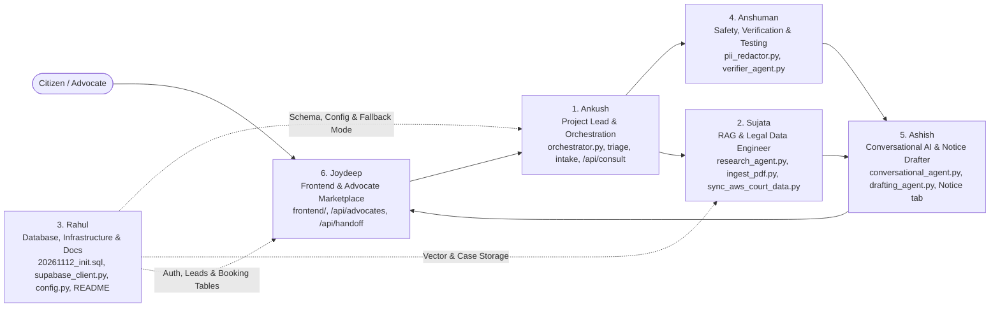
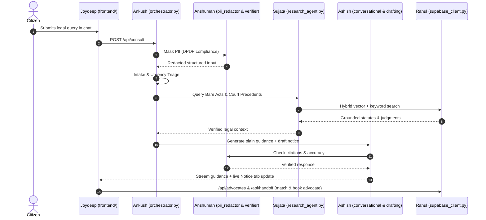
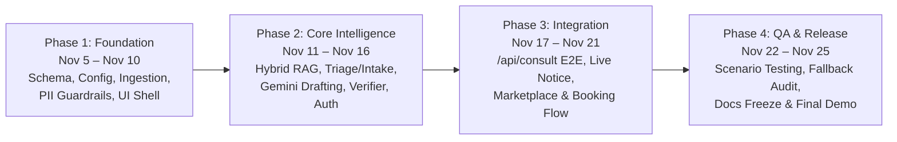

# OnlineVakeel.com — Team Roles, Ownership & Progress Timeline

> **Project Window:** November 5 – November 25, 2026 (21-Day Delivery Sprint)  
> **Team Size:** 6 Engineers  
> **Scope:** End-to-end AI Legal Triage, Hybrid RAG Research, DPDP-Compliant Verification, Live Legal Notice Drafting & Advocate Marketplace

---

## 1. System Ownership Map (Who Built What)

Every member owns a distinct vertical slice of **OnlineVakeel.com**, connected through clean API and agent boundaries:



---

## 2. Team Roster & Responsibilities

| # | Member | Role | Core Ownership | One-Line Pitch |
| :-: | :--- | :--- | :--- | :--- |
| **1** | **Ankush** | **Project Lead & Agent Orchestration** | `orchestrator.py`, `triage_agent.py`, `intake_agent.py`, `/api/consult` | *"I built the pipeline that turns a citizen's message into a classified, triaged, structured case."* |
| **2** | **Sujata** | **RAG & Legal Data Engineer** | `research_agent.py`, `ingest_pdf.py`, `sync_aws_court_data.py`, seeded Bare Acts & precedents | *"I built the hybrid search that grounds every answer in real Indian statutes and judgments."* |
| **3** | **Rahul** | **Database, Infrastructure & Documentation** | `20261112_init.sql`, `supabase_client.py`, `config.py`, `.env` files, README, API docs | *"I designed the schema and fallback mode, and wrote the setup guide and API reference."* |
| **4** | **Anshuman** | **Safety, Verification & Testing** | `pii_redactor.py`, `verifier_agent.py`, DPDP compliance, test scenarios | *"I made the system safe and trustworthy: PII masking, citation checks, and scenario-based testing."* |
| **5** | **Ashish** | **Conversational AI & Notice Drafter** | `conversational_agent.py`, `drafting_agent.py`, Gemini integration, Notice tab | *"I turn legal language into plain guidance and generate legal notices that update as the chat unfolds."* |
| **6** | **Joydeep** | **Frontend & Advocate Marketplace** | `frontend/`, advocate registration & login, dashboard, booking modal, `/api/advocates`, `/api/handoff`, `/api/advocate/leads` | *"I built everything users see, plus the advocate matching and booking flow."* |

---

## 3. End-to-End Request Flow Across Team Boundaries



---

## 4. Detailed Role Breakdown

### 1. Ankush — Project Lead & Agent Orchestration
- **Primary Modules:** `orchestrator.py`, `triage_agent.py` (`urgency_triage.py`), `intake_agent.py`, `/api/consult`
- **Key Deliverables:**
  - Designed the multi-agent state machine turning raw citizen narratives into structured legal cases.
  - Built intake extraction (jurisdiction, legal category, parties, timeline) and urgency triage routing.
  - Coordinated cross-team API contracts between frontend, safety, RAG, drafting, and database layers.

### 2. Sujata — RAG & Legal Data Engineer
- **Primary Modules:** `research_agent.py`, `ingest_pdf.py`, `sync_aws_court_data.py`
- **Key Deliverables:**
  - Built PDF ingestion and chunking pipelines for Indian Bare Acts and Supreme/High Court judgments.
  - Implemented AWS court data synchronization and seeded the initial legal knowledge base.
  - Engineered hybrid search (semantic + keyword) in `research_agent.py` to ground every response in real citations.

### 3. Rahul — Database, Infrastructure & Documentation
- **Primary Modules:** `20261112_init.sql`, `supabase_client.py`, `config.py`, `.env` templates, `README.md`, API docs
- **Key Deliverables:**
  - Architected the PostgreSQL/Supabase schema (`20261112_init.sql`) for cases, documents, advocates, and leads.
  - Implemented `supabase_client.py` with resilient local/in-memory fallback mode for offline or degraded runs.
  - Centralized environment configuration (`config.py`) and authored setup guides and API reference documentation.

### 4. Anshuman — Safety, Verification & Testing
- **Primary Modules:** `pii_redactor.py`, `verifier_agent.py`, DPDP compliance rules, test scenarios
- **Key Deliverables:**
  - Built DPDP-compliant PII detection and masking (`pii_redactor.py`) before data hits external LLMs.
  - Implemented `verifier_agent.py` to cross-check generated legal claims against retrieved statutes and precedents.
  - Authored end-to-end scenario test suites covering high-urgency triage, PII leakage, and hallucination prevention.

### 5. Ashish — Conversational AI & Notice Drafter
- **Primary Modules:** `conversational_agent.py`, `drafting_agent.py`, Gemini integration, Notice tab
- **Key Deliverables:**
  - Integrated Gemini models to translate complex statutory language into empathetic, plain-language citizen guidance.
  - Built `drafting_agent.py` to dynamically synthesize and update formal legal notices as the conversation evolves.
  - Delivered the live Notice tab experience synchronized with ongoing chat context.

### 6. Joydeep — Frontend & Advocate Marketplace
- **Primary Modules:** `frontend/`, `/api/advocates`, `/api/handoff`, `/api/advocate/leads`
- **Key Deliverables:**
  - Built the citizen-facing chat workspace, Notice tab UI, and responsive landing experience.
  - Implemented advocate registration, login, profile dashboard, and lead management (`/api/advocate/leads`).
  - Built the advocate matching engine (`/api/advocates`), case handoff (`/api/handoff`), and booking modal flow.

---

## 5. Logical Progress Timeline (November 5 – November 25)

The 21-day schedule is structured in **4 logical dependency-driven phases** so foundational infrastructure, data ingestion, and safety guardrails land before agent orchestration and UI integration.



### Visual Gantt Overview (Nov 5 – Nov 25)

```text
Member      | Nov 5-7   | Nov 8-10  | Nov 11-13 | Nov 14-16 | Nov 17-19 | Nov 20-22 | Nov 23-25 |
------------+-----------+-----------+-----------+-----------+-----------+-----------+-----------+
Rahul (DB)  | █████████ | █████████ | █████░░░░ | ░░░░░░░░░ | ████░░░░░ | █████████ | █████████ |
            | Config &  | Fallback  | 1112 SQL  |           | API Docs  | Setup &   | Final     |
            | Schema v1 | Mode      | Migration |           | Draft     | Env Audit | Docs Sign |
------------+-----------+-----------+-----------+-----------+-----------+-----------+-----------+
Sujata (RAG)| █████████ | █████████ | █████████ | █████████ | █████░░░░ | ████░░░░░ | ░░░░░░░░░ |
            | PDF Pipe  | Bare Acts | AWS Court | Hybrid    | Retrieval | Citation  |           |
            | Setup     | Seeding   | Data Sync | Search    | Tuning    | QA        |           |
------------+-----------+-----------+-----------+-----------+-----------+-----------+-----------+
Anshuman    | █████████ | █████████ | ████░░░░░ | █████████ | █████████ | █████████ | █████░░░░ |
(Safety/QA) | DPDP Spec | PII Mask  |           | Verifier  | Scenario  | Red-Team  | Final QA  |
            |           | Module    |           | Agent     | Suite     | & Audits  | Sign-off  |
------------+-----------+-----------+-----------+-----------+-----------+-----------+-----------+
Ankush      | █████████ | █████████ | █████████ | █████████ | █████████ | █████░░░░ | █████████ |
(Lead/Orch) | Arch &    | /api/     | Intake &  | Pipeline  | E2E Orch  | Edge Case | Demo &    |
            | Contracts | consult   | Triage    | Wiring    | Tuning    | Fixes     | Release   |
------------+-----------+-----------+-----------+-----------+-----------+-----------+-----------+
Ashish      | ░░░░░░░░░ | █████████ | █████████ | █████████ | █████████ | █████░░░░ | ████░░░░░ |
(Conv/Draft)|           | Gemini    | Convers.  | Drafting  | Live      | Notice    | Prompt    |
            |           | Setup     | Agent     | Agent     | NoticeTab | Polish    | Freeze    |
------------+-----------+-----------+-----------+-----------+-----------+-----------+-----------+
Joydeep     | █████████ | █████████ | █████████ | █████████ | █████████ | █████████ | █████░░░░ |
(UI/Mkt)    | Frontend  | Chat UI   | Advocate  | Dashboard | Booking   | Full UI   | Release   |
            | Scaffold  | Shell     | Auth/API  | & Leads   | & Handoff | Polish    | Freeze    |
```

---

### Detailed Phase-by-Phase Milestone Log

#### Phase 1: Foundation, Schema & Guardrails (Nov 5 – Nov 10)
| Dates | Member | Milestone & Rationale |
| :--- | :--- | :--- |
| **Nov 5 – Nov 7** | **Ankush** | Defined system architecture, agent interfaces, and `/api/consult` contract so all teams could build in parallel. |
| **Nov 5 – Nov 8** | **Rahul** | Built `config.py`, `.env` templates, and initial database schema; added `supabase_client.py` with local fallback mode so teammates could develop without cloud lock-in. |
| **Nov 5 – Nov 9** | **Sujata** | Built `ingest_pdf.py` and began parsing & seeding foundational Indian Bare Acts. |
| **Nov 6 – Nov 10** | **Anshuman** | Defined DPDP compliance rules and implemented `pii_redactor.py` so citizen PII is masked before any LLM call. |
| **Nov 6 – Nov 10** | **Joydeep** | Scaffolded `frontend/` application structure, routing, and base consultation chat shell. |
| **Nov 8 – Nov 10** | **Ashish** | Configured Gemini SDK integration and tested baseline legal-to-plain-language prompt templates. |

#### Phase 2: Core Agent Intelligence, RAG & Marketplace (Nov 11 – Nov 16)
| Dates | Member | Milestone & Rationale |
| :--- | :--- | :--- |
| **Nov 11 – Nov 12** | **Rahul** | Finalized and locked the production database migration (`20261112_init.sql`) covering cases, vectors, advocates, and leads. |
| **Nov 11 – Nov 15** | **Sujata** | Built `sync_aws_court_data.py` for court precedents and implemented hybrid search in `research_agent.py`. |
| **Nov 11 – Nov 15** | **Ankush** | Implemented `intake_agent.py` and `triage_agent.py`, wiring them into `orchestrator.py`. |
| **Nov 11 – Nov 16** | **Ashish** | Built `conversational_agent.py` for citizen guidance and `drafting_agent.py` for structured legal notice generation. |
| **Nov 13 – Nov 16** | **Anshuman** | Implemented `verifier_agent.py` to validate statute citations and prevent unsupported legal claims. |
| **Nov 11 – Nov 16** | **Joydeep** | Built advocate registration/login, advocate dashboard, `/api/advocates`, and `/api/advocate/leads`. |

#### Phase 3: End-to-End Integration & Marketplace Flow (Nov 17 – Nov 21)
| Dates | Member | Milestone & Rationale |
| :--- | :--- | :--- |
| **Nov 17 – Nov 19** | **Ankush** | Connected the full `/api/consult` pipeline across PII redaction, intake, triage, RAG research, drafting, and verification. |
| **Nov 17 – Nov 20** | **Ashish & Joydeep** | Integrated the live **Notice tab** so drafted legal notices update dynamically in the UI as the chat unfolds. |
| **Nov 17 – Nov 20** | **Joydeep** | Completed `/api/handoff` and the advocate booking modal, closing the loop from AI triage to human advocate consultation. |
| **Nov 17 – Nov 21** | **Sujata** | Tuned hybrid retrieval weights and validated citation recall across seeded Bare Acts and AWS court judgments. |
| **Nov 17 – Nov 21** | **Anshuman** | Executed scenario-based test suites (urgency escalation, PII masking, citation verification) and logged edge-case fixes. |
| **Nov 18 – Nov 21** | **Rahul** | Drafted the API reference and setup documentation matching the integrated endpoints and `.env` configuration. |

#### Phase 4: QA, Documentation Freeze & Release (Nov 22 – Nov 25)
| Dates | Member | Milestone & Rationale |
| :--- | :--- | :--- |
| **Nov 22 – Nov 23** | **Anshuman & Ankush** | Conducted full end-to-end red-team testing, stress-tested urgency triage, and resolved integration edge cases. |
| **Nov 22 – Nov 24** | **Rahul** | Verified clean-room setup using `.env` + fallback mode and finalized `README.md` and API docs. |
| **Nov 23 – Nov 24** | **Joydeep & Ashish** | Finalized UI/UX polish, Notice tab formatting, and advocate booking confirmation flows. |
| **Nov 25** | **All 6 Members** | Final release freeze, end-to-end demo rehearsal, and production readiness sign-off. |
